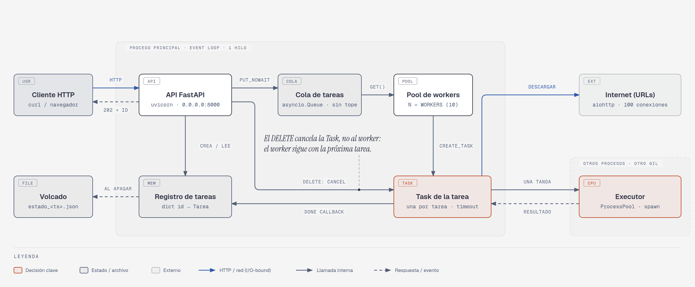
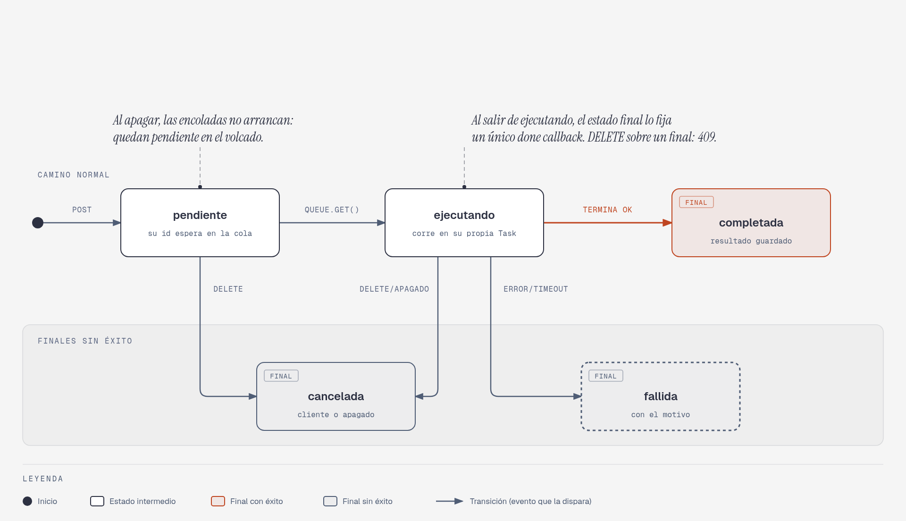
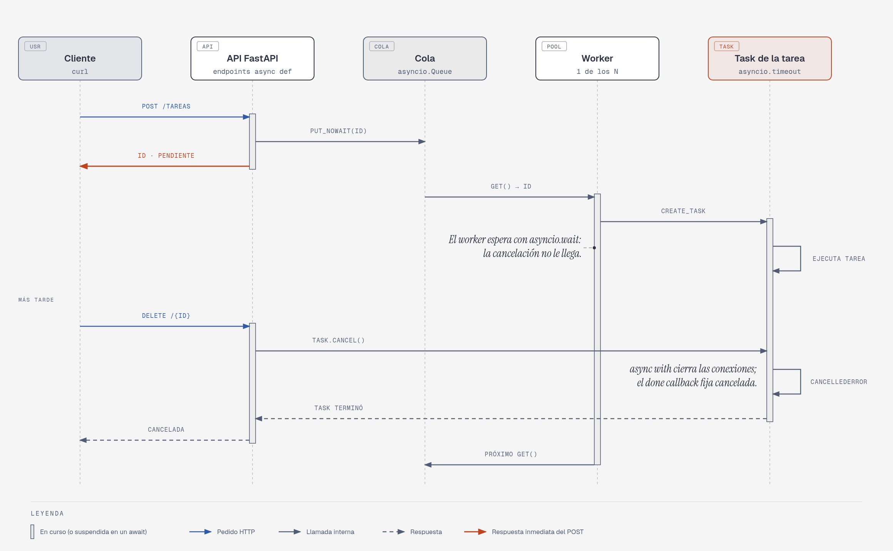
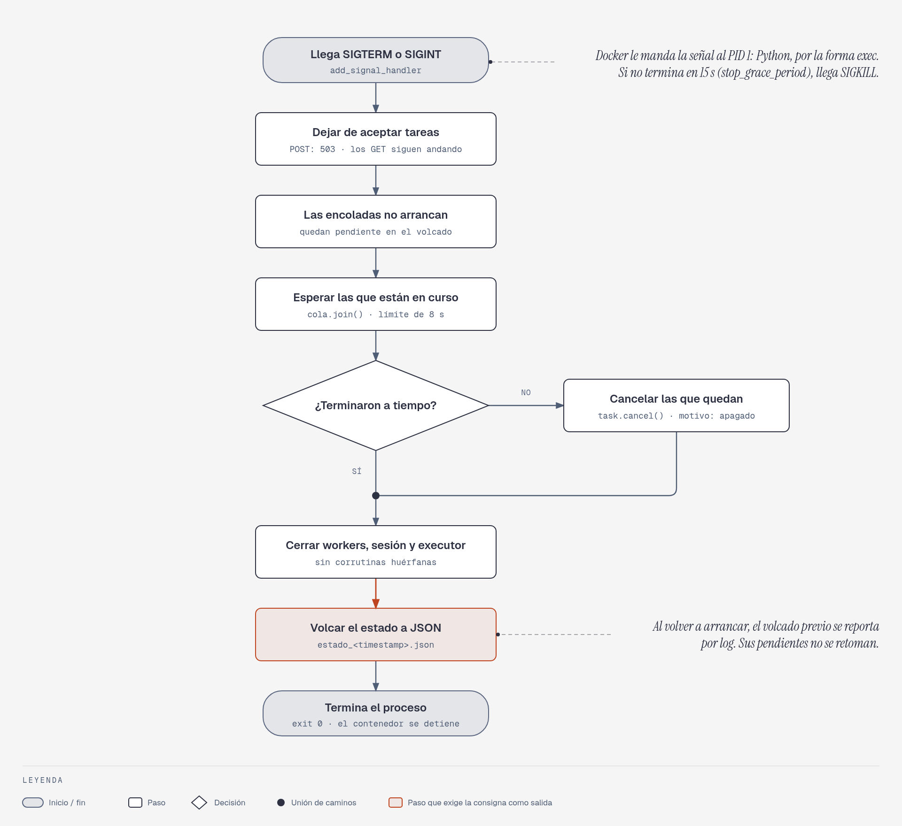

# TP2: Plataforma de Tareas Distribuidas

**Computación II — Universidad de Mendoza — 2026**

Servicio HTTP al que se le encargan tareas. El `POST` responde al instante con un
id; la tarea espera en una `asyncio.Queue` y la ejecuta un pool de workers
(corrutinas). Se puede consultar su estado, cancelarla mientras corre y apagar el
servicio de forma ordenada, volcando el estado a JSON.

## 1. Descripción y uso

```bash
docker compose up --build     # la API queda en http://localhost:8000 (docs en /docs)
docker compose down           # manda SIGTERM: apagado ordenado y volcado en ./datos
```

| Método | Ruta | Qué hace | Códigos |
|--------|------|----------|---------|
| `POST` | `/tareas` | Encola una tarea; devuelve `id` y `estado` | 202, 422, 503 si se está apagando |
| `GET` | `/tareas?estado=` | Lista las tareas, sin el resultado; filtro opcional | 200, 422 |
| `GET` | `/tareas/{id}` | Estado y resultado de una tarea | 200, 404 |
| `DELETE` | `/tareas/{id}` | Cancela una tarea encolada o en ejecución | 200, 404, 409 si ya terminó |
| `GET` | `/estadisticas` | Totales por estado, tiempos promedio, workers ocupados | 200 |

Todas las tareas aceptan un `timeout` opcional en segundos (por defecto, 300).

```bash
API=http://localhost:8000

# esperar: duerme N segundos. Sirve para probar cancelación y timeouts.
curl -X POST $API/tareas -H 'Content-Type: application/json' \
     -d '{"tipo": "esperar", "segundos": 30}'
# -> {"id":"cf5acf...","estado":"pendiente"}

curl $API/tareas/cf5acf...                 # estado y resultado
curl -X DELETE $API/tareas/cf5acf...       # cancela aunque esté en ejecución

# Timeout: a los 2 s pasa a `fallida` con el motivo.
curl -X POST $API/tareas -H 'Content-Type: application/json' \
     -d '{"tipo": "esperar", "segundos": 30, "timeout": 2}'

# hashear: SHA-256 iterado. Corre en otro proceso.
curl -X POST $API/tareas -H 'Content-Type: application/json' \
     -d '{"tipo": "hashear", "texto": "hola", "iteraciones": 2000000}'

# descargar: por cada URL devuelve código de estado, tamaño y tiempo.
curl -X POST $API/tareas -H 'Content-Type: application/json' \
     -d '{"tipo": "descargar", "urls": ["https://example.com", "https://www.python.org"]}'

# Con "concurrente": false, las baja de a una (es lo que compara la medición 1).

curl "$API/tareas?estado=completada"
curl $API/estadisticas
```

Variables de entorno del compose: `WORKERS` (10), `MODO_HASH` (`proceso`, `hilo` o
`bloqueante`) y `LIMITE_APAGADO` (8 s). Las demás están en `app/config.py`.

```bash
WORKERS=50 docker compose up --build
```

Para ver el apagado ordenado: encargá un `esperar` de 60 s, corré
`docker compose down` y mirá `docker compose logs` y la carpeta `datos/`.

### Estructura

| Archivo | Responsabilidad |
|---------|-----------------|
| `app/main.py` | Endpoints, `lifespan` y señales |
| `app/pool.py` | Cola, workers, registro de tareas y drenado |
| `app/tareas.py` | Las tres tareas y la creación del executor |
| `app/cpu.py` | Lo que corre en los procesos del executor |
| `app/modelos.py` | Estados, validación de pedidos y registro de una tarea |
| `app/persistencia.py` | Volcado a JSON y reporte al arrancar |
| `mediciones/` | Scripts y resultados crudos (`resultados.txt`) |

## 2. Arquitectura



**Flujo de una tarea:** el `POST` valida el body, registra la tarea como `pendiente`,
pone su id en la cola y responde. Un worker saca el id, la pasa a `ejecutando` y crea
una `Task` hija. Cuando la hija termina, un *done callback* fija el estado final
(`completada`, `fallida` o `cancelada`) y el worker vuelve a la cola.

### Ciclo de vida de una tarea



### Encargar una tarea y cancelarla



Los diagramas también están como HTML en [`docs/diagramas/`](docs/diagramas/).

## 3. Decisiones de diseño

### ¿Por qué `asyncio.Queue` y no `queue.Queue`?

`queue.Queue.get()` bloquea **el hilo** que la llama, y acá hay un solo hilo: el del
event loop. Un worker esperando trabajo congelaría toda la API. `asyncio.Queue.get()`
suspende solo **la corrutina**, y el loop sigue atendiendo a las demás. Además,
`queue.Queue` paga locks pensados para hilos, que acá no hacen falta.

### ¿Cómo evitás que una tarea CPU-bound congele la API?

`hashear` corre en un `ProcessPoolExecutor`, a través de `run_in_executor`. El loop
hace `await` del resultado y mientras tanto sigue atendiendo requests. Se eligieron
procesos y no hilos por el GIL: con hilos, el cálculo le compite el GIL al hilo del
loop. La medición 2 lo muestra: la mediana de `GET /tareas` sube a 10,8 ms con hilos y
queda en 0,6 ms con procesos, igual que sin carga. En `pruebas/test_gil.py`, 4 hashes
de 2.000.000 de iteraciones (una sola tarea tarda 0,65 s) tardaron 2,57 s con hilos y
0,73 s con procesos.

El método de arranque es `spawn`, explícito: da un intérprete limpio en vez de copiar
con `fork` un proceso que ya tiene un loop e hilos andando. Por eso la guarda
`if __name__ == '__main__'` es obligatoria.

### ¿Cómo implementaste la cancelación, y qué pasa con los recursos a medio usar?

Cada tarea corre en **su propia `Task`**, creada por el worker con `create_task`. El
`DELETE` llama a `task.cancel()` sobre esa `Task`, no sobre el worker, y el worker la
espera con `asyncio.wait`, que no relanza el resultado: la cancelación no le llega.
Sigue vivo para la próxima tarea. Ninguna tarea captura `CancelledError`, así que nunca
se traga. El estado final se fija en un único lugar, un *done callback*, que
corre incluso si la `Task` se canceló antes de dar su primer paso.

El `DELETE` espera a que la `Task` termine de limpiar antes de responder, así que
devuelve el estado final. Una tarea `pendiente` se marca `cancelada`, y el worker
ignora su id cuando lo saca de la cola.

| Tarea | Qué pasa con la cancelación | Recursos |
|-------|-----------------------------|----------|
| `esperar` | `CancelledError` en el `asyncio.sleep` | Ninguno que liberar |
| `descargar` | `gather` cancela a sus hijas y espera a que terminen | El `async with` de cada request cierra su conexión |
| `hashear` | `CancelledError` en el `await` de la tanda | Las tandas que faltan no se piden; la que corre termina y se descarta |

**Comprobado cancelando a mitad de descarga**, con 5 URLs que nunca terminan: se pasó
de 5 conexiones en uso a 0, el servidor vio los 5 cortes y no quedó ninguna `Task` del
cliente viva. Con un timeout a mitad de descarga pasó lo mismo. Para repetirlo:

```bash
docker compose run --rm -T -e PYTHONPATH=/srv api python - < pruebas/cancelar_descarga.py
```

**No se puede interrumpir un cálculo en otro proceso.** Por eso el hash va **por
tandas** de 100.000 iteraciones, cada una con su `run_in_executor`: una cancelación o
un timeout liberan el worker enseguida y el slot del executor se libera en cuanto
termina la tanda en curso (unos 37 ms). Tiene un costo: 10.000.000 de iteraciones
tardan 3,72 s por tandas contra 3,51 s de una sola vez, un 6 % más. También hace justo
el reparto: con más hashes que procesos, las tandas se turnan en la cola del executor.

Los timeouts usan `asyncio.timeout()`, que por dentro hace lo mismo que un `DELETE`
(cancela la `Task`), pero termina como `TimeoutError` y la tarea pasa a `fallida` con
el motivo. Acá cubre un solo `await`, así que `wait_for` también habría alcanzado.

### ¿Qué pasa si un worker lanza una excepción no capturada?

Sin protección, ese worker moriría en silencio: su `Task` guardaría la excepción, nadie
la leería y el pool quedaría con un worker menos sin que nada lo avise. Acá hay dos
barreras:

1. Un error **de la tarea** ocurre en la `Task` hija. El *done callback* lo lee y la
   tarea pasa a `fallida` con el motivo. El worker ni se entera.
2. Un error **del propio worker** lo atrapa un `except Exception` dentro del bucle, que
   lo loguea y sigue. `task_done()` va en un `finally`, para que `join()` no quede
   colgado. `CancelledError` no entra en ese `except` porque hereda de `BaseException`,
   y así el apagado puede cancelar a los workers.

`/estadisticas` informa `workers.vivos` para poder comprobarlo. Probado matando un
proceso del pool con `kill -9`: las tareas `hashear` pasan a `fallida` con
`BrokenProcessPool`, y los 10 workers siguen vivos.

### ¿Dónde podría bloquearse el event loop?

- **`GET /tareas`**: arma y serializa toda la lista dentro del loop. Es el bloqueo más
  grande que queda. Con 100.000 tareas, un `GET /tareas/{id}` lanzado mientras tanto quedó
  trabado entre 720 y 810 ms, igual que el propio listado, así que es bloqueo real y no solo
  transferencia (`pruebas/bloqueo_get.py`).
- **`/estadisticas`**: también recorre todo el registro (16 ms con 100.000 tareas).
- **Arrancar los procesos del pool**: ocurre bajo demanda y en el hilo del loop. Con 12 hashes
  a la vez y el pool en frío, el peor `GET /estadisticas` fue de 12,3 ms, contra 5,6 ms con el
  pool caliente. `pruebas/test_tics.py`, que crea el pool en frío, muestra lo mismo: un atraso
  de 57 ms que baja a 0,9 ms si el pool ya arrancó.
- **Menores, sin medir por separado**: escribir un log y armar la lista de tareas para el volcado.
- **Ya resueltos**: el hash va a otro proceso; `executor.shutdown` y el disco, a `to_thread`.
  El modo `MODO_HASH=bloqueante` existe solo para la medición 2.

### Validación de entrada

Pydantic valida el body antes de entrar al endpoint, y un pedido inválido recibe 422 sin
llegar a la cola. Hay dos casos que se ven bien pero rompen después, porque no se pueden
escribir en JSON o UTF-8: `Infinity` y los surrogates sueltos como `"\ud800"`. Por eso
se rechazan, y la respuesta de error no repite el valor recibido.

### ¿Por qué `aiohttp`?

Es un cliente hecho para asyncio, pensado para muchas conexiones simultáneas. Se usa
una sola `ClientSession`, creada en el `lifespan`: reutiliza conexiones y su `limit`
pone un techo global (ver medición 3c). `httpx` tiene una API más parecida a `requests`,
pero eso acá no aportaba. No se midieron uno contra otro.

### Apagado ordenado



`SIGTERM` y `SIGINT` llegan a un handler registrado con `loop.add_signal_handler`, que
corre dentro del loop y puede crear una `Task`. La secuencia es:

1. `aceptando = False`: los `POST` reciben 503, y los `GET` siguen funcionando.
2. Los workers dejan de arrancar tareas. Las que estaban en cola **quedan `pendiente`**
   en el volcado: refleja que nunca corrieron.
3. `cola.join()` con un límite de 8 s. Si vence, se cancelan las que siguen corriendo.
4. Se cierran los workers, la sesión HTTP y el executor; se escribe el volcado con
   `to_thread`, a un temporal y con un `os.replace` atómico.

En el `Dockerfile`, `CMD` usa la forma exec para que Python sea PID 1 y reciba la señal.
`stop_grace_period` es de 15 s porque los 10 s por defecto de Docker dejarían muy poco
margen sobre los 8 s de límite.

**Comprobado:** con 10 tareas largas (un hash incluido) y 5 en cola, `docker compose
stop` tardó 8,5 s y salió con `exit=0`; durante el drenado, `POST` dio 503 y `GET` 200.
El volcado quedó con 10 `cancelada` y 5 `pendiente`. Al volver a arrancar, el log
reportó el volcado previo.

## 4. Mediciones

Todos los números son de `mediciones/correr_todo.sh`, con la salida cruda en
[`mediciones/resultados.txt`](mediciones/resultados.txt). **Máquina:** AMD Ryzen 5 5600
(6 núcleos físicos, 12 lógicos), en Docker. Los clientes de medición corren en el mismo
contenedor que la API.

### Medición 1: concurrencia I/O

Una tarea `descargar` con 20 URLs, con `concurrente` en `false` o `true`. Mediana de 5
repeticiones.

| Destino | Secuencial | Concurrente | Speedup |
|---------|-----------|-------------|---------|
| Servidor local, 0,5 s por URL, 100 KiB | 10,024 s | 0,502 s | **19,95x** |
| Internet real, `https://example.com` | 0,760 s | 0,036 s | **21,41x** |

**Interpretación.** Con el servidor local, secuencial tarda la suma (20 × 0,5 s) y
concurrente lo que la más lenta (0,5 s): el speedup roza el máximo teórico de 20, porque
casi todo el tiempo es espera, y mientras se espera el loop atiende otra descarga.

**El dato de Internet es muy ruidoso, y el confiable es el del servidor local.** Una corrida
anterior, con la misma medición, dio 12,45x (0,597 s contra 0,048 s). Pasar de 20x no significa
más paralelismo: 20 es el tope solo si cada URL tarda siempre lo mismo, pero secuencial y
concurrente se miden en momentos distintos, la red cambia entre uno y otro, y con tiempos tan
bajos cualquier variación pesa. En esta corrida, las repeticiones secuenciales fueron de 0,488 s
a 1,268 s.

Se usa la mediana porque en una corrida previa una repetición secuencial contra Internet dio
11,3 s (las otras, unos 0,55 s), lo que llevaba el speedup por promedio a 62x. No se reprodujo
en las corridas siguientes y no se investigó la causa.

### Medición 2: el event loop bloqueado

Un `hashear` de 10.000.000 de iteraciones (~3,6 s) mientras un cliente hace `GET /tareas`
sin parar. Pool ya calentado.

| `MODO_HASH` | Duración del hash | GETs durante el hash | Mediana | p95 | Máximo |
|-------------|-------------------|----------------------|---------|-----|--------|
| Sin carga (línea de base, antes de cada modo) | — | 100 | 0,6–0,7 ms | 0,8–0,9 ms | 1,0–1,5 ms |
| `bloqueante` (en el loop) | 3,51 s | **1** | **3.506,4 ms** | 3.506,4 ms | 3.506,4 ms |
| `hilo` (`ThreadPoolExecutor`) | 3,68 s | 111 | 10,8 ms | 16,1 ms | 16,5 ms |
| `proceso` (`ProcessPoolExecutor`) | 3,72 s | 334 | **0,6 ms** | 0,9 ms | 1,0 ms |

**Interpretación.** Sin executor, el servidor quedó sordo: el único `GET` tardó lo mismo
que el hash, unas 5.800 veces la mediana normal. El hash casi no cambia de duración en
los tres casos: lo que cambia es **quién queda bloqueado**. Con hilos el loop responde,
pero compite por el GIL: `hashlib` no lo suelta con entradas chicas, y cada request
espera a que el hilo lo ceda. Con procesos hay otro GIL en otro núcleo, y la latencia es
idéntica a la de la línea de base.

### Medición 3: techo del pool

Cada tipo de tarea se satura por un motivo distinto, así que se midieron por separado.

**3a. `esperar(1 s)`, `WORKERS=10`: el límite es el pool.**

| Tareas | Total | Tareas/s | Ejecución promedio | Espera en cola promedio |
|-------:|------:|---------:|-------------------:|------------------------:|
| 1 | 1,00 s | 1,0 | 1,001 s | 0,000 s |
| 10 | 1,00 s | 10,0 | 1,001 s | 0,000 s |
| 20 | 2,00 s | 10,0 | 1,001 s | 0,500 s |
| 50 | 5,01 s | 10,0 | 1,001 s | 1,995 s |
| 100 | 10,02 s | 10,0 | 1,001 s | 4,496 s |

Hasta 10 tareas, nada se degrada. Después, cada tarea sigue tardando 1 s, pero se forma
cola: el rendimiento queda clavado en `WORKERS / duración` = 10 tareas/s. No falta CPU,
falta gente: subir `WORKERS` lo resuelve.

**3b. `hashear` de 2.000.000 de iteraciones, `WORKERS=64`: el límite es la CPU.**

| Tareas | Total | Tareas/s | Ejecución promedio |
|-------:|------:|---------:|-------------------:|
| 1 | 0,74 s | 1,4 | 0,740 s |
| 2 | 0,77 s | 2,6 | 0,764 s |
| 4 | 0,81 s | 4,9 | 0,794 s |
| 6 | 0,95 s | 6,3 | 0,913 s |
| 8 | 1,15 s | 7,0 | 1,083 s |
| 12 | 1,62 s | 7,4 | 1,580 s |
| 24 | 3,22 s | 7,5 | 3,147 s |
| 48 | 6,56 s | 7,3 | 6,387 s |

El rendimiento se aplana en unas **7,4 tareas/s, alrededor de 5,5 veces una sola**, no
12. Es consistente con los 6 núcleos físicos: los 12 lógicos comparten unidades de
ejecución, y a partir de 6 tareas cada una ya tarda más. Más workers no ayudan: la espera
en cola es ~0 y el tiempo pasa dentro del executor. A diferencia de 3a, acá el recurso
escaso es de verdad la CPU.

**3c. `descargar` de una URL de 0,5 s, `WORKERS=2000`: el límite son las conexiones.**

| Tareas | Total | Tareas/s | Ejecución promedio |
|-------:|------:|---------:|-------------------:|
| 10 | 0,51 s | 19,7 | 0,505 s |
| 100 | 0,56 s | 178,8 | 0,512 s |
| 200 | 1,05 s | 189,6 | 0,747 s |
| 500 | 2,61 s | 191,3 | 1,489 s |
| 1000 | 5,13 s | 194,9 | 2,668 s |

El techo teórico es `LIMITE_CONEXIONES / demora` = 100 / 0,5 s = 200 tareas/s, y se
midieron unas 195. Pasadas las 100 tareas, la "ejecución" crece porque incluye esperar
una conexión libre dentro de aiohttp. Es un límite elegido para no abrir conexiones sin
freno, no un límite físico.

**3d. El propio event loop, con `esperar(1 s)` y `WORKERS=10000`.**

| Tareas | POST/s | `GET /tareas/{id}` (mediana) | `/estadisticas` (mediana) | `GET /tareas` (mediana) | Ejecución promedio (ideal 1 s) |
|-------:|-------:|-----------------------------:|--------------------------:|------------------------:|-------------------------------:|
| 1.000 | 3.341 | 0,3 ms | 0,8 ms | 7,9 ms | 1,024 s |
| 5.000 | 3.535 | 0,3 ms | 2,3 ms | 49,9 ms | 1,050 s |
| 10.000 | 3.301 | 0,3 ms | 6,4 ms | 107,9 ms | 1,091 s |

El techo de la API está en unos **3.400 POST/s**: un solo hilo parseando HTTP y validando
con Pydantic. El límite no era el cliente: dos clientes a la vez sumaron 3.437 POST/s, lo
mismo que uno solo. El `sleep` de 1 s llega a tardar 1,09 s porque el loop ya tiene
demasiado para hacer: es lo primero que se ve cuando se satura. La latencia de
`GET /tareas` crece lineal con el registro.

**3e. Si te mando 10.000 tareas de golpe, ¿qué se rompe primero?**

En `resultados.txt` figura como 3f; el 3e de ese archivo es la prueba de los dos clientes
de arriba. Con la configuración por defecto (`WORKERS=10`), usando `esperar(1 s)`:

| Tareas | POST/s | Memoria de la API | `GET /tareas` (mediana) | `/estadisticas` (mediana) | Apagado |
|-------:|-------:|------------------:|------------------------:|--------------------------:|--------:|
| 10.000 | 4.111 | 58 → 62 MiB | 65,3 ms | 1,8 ms | 1,0 s |
| 100.000 | 4.087 | 58 → 115 MiB | 816,0 ms | 16,2 ms | 2,0 s (volcado de 38,5 MB) |

**No se rompe la memoria.** Lo primero que se degrada es la **espera**: el servidor acepta
las 10.000 en 2,4 s, pero terminarlas tardaría unos 1.000 s (calculado: 10.000 × 1 s / 10
workers). Lo segundo es **`GET /tareas`**, que arma y serializa toda la lista dentro del
loop: con 100.000 tareas bloquea el loop unos 0,8 s en cada llamada, y **eso congela a todos
los demás**. De lo medido, es el bloqueo más grande que queda en el código.

Acá se llega a unos 4.100 POST/s, contra 3.400 con 10.000 workers. Probablemente sea porque con 10
workers casi todo `POST` solo encola, mientras que con 10.000 también despierta a un worker que crea
una `Task`; no se midió por separado.

## 5. Conceptos del curso aplicados

| Concepto | Clase | Dónde está en el código |
|----------|-------|-------------------------|
| Señales: `SIGTERM`, `SIGINT`, `add_signal_handler` | 6 | `main.py`: `_al_recibir_senal` |
| Docker, puertos, `0.0.0.0`, PID 1 | 1 y 2 | `Dockerfile`, `docker-compose.yml` |
| Procesos, `fork` y `spawn`, guarda de `__main__` | 8 y 9 | `tareas.py`: `crear_executor`; `main.py` |
| Hilos y GIL | 10 | Medición 2, modo `hilo`; `pruebas/test_gil.py` |
| Productor-consumidor | 11 | `pool.py`: `encolar` produce, `_worker` consume |
| Multiplexing: el loop espera con `epoll` | 17 | Por eso 10.000 `esperar` no necesitan 10.000 hilos (3d) |
| Cooperación: solo se cambia de corrutina en un `await` | 18 | Medición 2, modo `bloqueante`; `pruebas/scheduler.py` |
| HTTP, FastAPI, Pydantic, `lifespan` | 19 | `main.py`, `modelos.py` |
| I/O asíncrono de red, `gather` contra `for` con `await` | 20 | `tareas.py`: `descargar`; medición 1 |
| `Queue`, `create_task`, cancelación, timeouts | 21 | `pool.py`: `_ejecutar`, `_correr`, `drenar` |
| `concurrent.futures`, `run_in_executor`, `Future` | 22 | `tareas.py`: `hashear` |

> El pool de workers consume de una `asyncio.Queue` compartida. Es el mismo patrón
> productor-consumidor de la clase 11, pero con corrutinas en vez de threads: acá no hace
> falta `Lock` porque el event loop no interrumpe entre `await`s.

En concreto, `self._ocupados += 1`, o revisar `tarea.estado` y después cambiarlo, no tienen
ningún `await` en el medio, así que nada se puede intercalar. Un `Lock` sí haría falta si
hubiera que mantener un dato consistente **a través** de un `await`. Por eso los endpoints
son `async def`: con `def`, FastAPI los correría en un threadpool, y ahí sí habría carreras
sobre el registro.

**`gather` contra `for` con `await`:** los dos están en `descargar`. El `for` no empieza una
URL hasta terminar la anterior; `gather` crea una `Task` por URL y las deja avanzar a la
vez. Es la diferencia entre 10,0 s y 0,5 s de la medición 1.

**`time.sleep` contra `asyncio.sleep`:** el primero duerme el hilo, y con él todo el loop. El
segundo suspende la corrutina y le devuelve el control al loop. El modo `bloqueante` de la
medición 2 es exactamente ese bug, y cuesta 3,5 s de sordera.

## 6. Limitaciones conocidas

- **Cola sin límite y registro que nunca se purga.** El `POST` acepta siempre, sin
  backpressure: ante una avalancha crecen la espera y la memoria, sin rechazar a nadie
  (medición 3e). Una cola acotada que responda 503 lo resolvería.
- **`GET /tareas` no tiene paginación** y es lineal en la cantidad de tareas: con 100.000
  bloquea el loop unos 0,8 s por llamada. `/estadisticas` también es lineal, aunque pesa menos.
- **Las tareas `pendiente` no se retoman.** El volcado las registra y el arranque solo lo
  informa; se pierde ese trabajo pedido.
- **Si muere un proceso del pool, el executor queda roto hasta reiniciar**: todo `hashear`
  posterior termina `fallida` con `BrokenProcessPool`. El resto del servicio sigue andando.
- **La cancelación del hash llega entre tandas**: la tanda en curso sigue hasta terminar,
  y tandas más chicas cortarían antes a cambio de más overhead.
- **El timeout corre desde que la tarea empieza a ejecutarse**, no desde el `POST`: el tiempo
  en cola no cuenta.
- **Cancelar o agotar el timeout descarta el resultado parcial**, incluidas las URLs que
  ya habían terminado.
- **`descargar` queda `completada` aunque fallen todas sus URLs**: el error va por URL.
- **El volcado solo ocurre en un apagado ordenado.** Con `SIGKILL` o un corte de luz se
  pierde todo. Dos volcados en el mismo segundo se pisarían, y los archivos se acumulan
  sin límite. Quedan a nombre de `root` porque el contenedor corre como root.
- **Sin autenticación ni rate limiting**, y `descargar` pide cualquier URL que le pasen,
  así que no debería exponerse fuera de un entorno de prueba.
- **Un solo proceso de API**: el techo es de 3.400 a 4.100 POST/s, según la cantidad de workers.
- **Las mediciones comparten máquina** entre cliente y servidor, y los números de Internet
  dependen de la red del momento.

## 7. Lo que aprendí

> **PENDIENTE:** esta sección la tengo que escribir yo, con mis palabras (2 o 3 párrafos).
